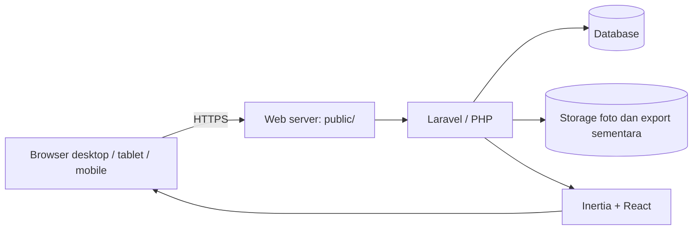
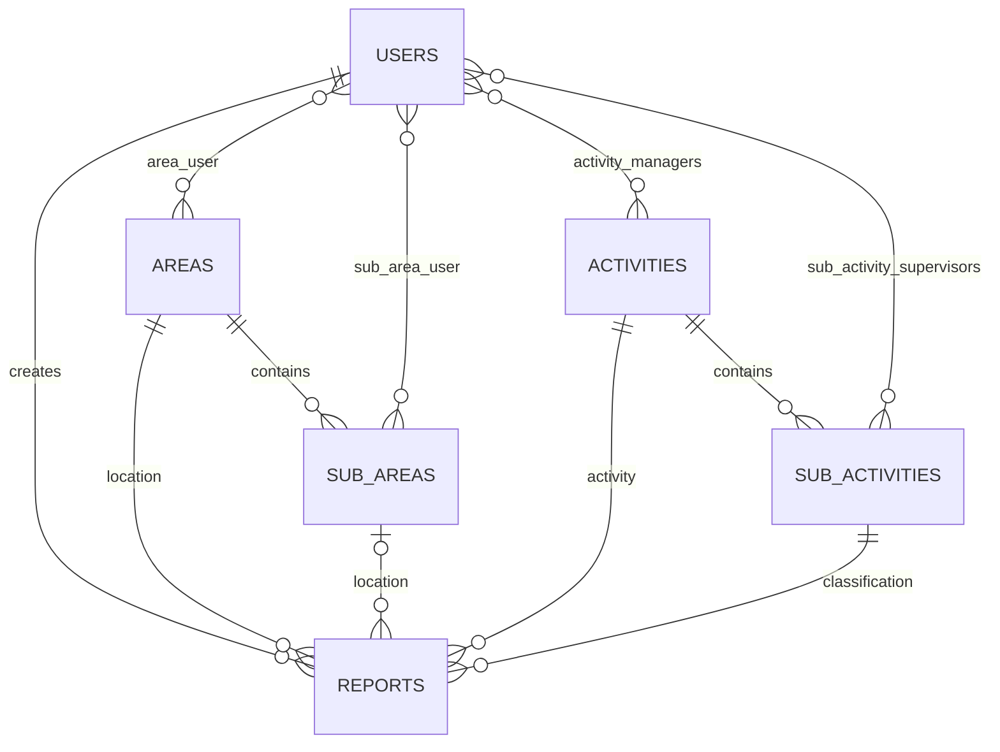

# Dokumentasi Teknis dan Operasional untuk Tim IT

**PT Ultrajaya Milk Industry & Trading Company Tbk — Internal Ticketing & Reporting**  
Baseline kode workspace: 27 Oktober 2026

Dokumen ini adalah panduan handover teknis berdasarkan implementasi repository pada tanggal di atas, termasuk perubahan yang masih berada di working tree. Dokumen ini bukan bukti bahwa aplikasi sudah siap production. Tim IT perlu menetapkan infrastruktur, menguji release yang akan dipasang, dan menyelesaikan temuan pada bagian 12 sebelum go-live.

Dokumen pendamping: [panduan deployment](panduan-deploy.md), [fitur dan matriks RBAC](modul-fitur-dan-matriks-rbac.md), [teknis per role](dokumentasi-teknis-per-role.md), [model Activity](activity-data-model.md), dan [pengujian RBAC](pengujian-rbac.md).

## 1. Ringkasan sistem

Aplikasi internal untuk mencatat laporan lapangan, mengelola master Area dan Activity, menugaskan reviewer/ticket closer, serta memantau dan mengekspor laporan. Kategori ditentukan oleh Sub-activity:

- `ISSUE`: dapat berstatus open atau closed sesuai permission dan assignment.
- `REPORT`: observasi yang tidak melalui proses close.
- Kategori disimpan dalam `category_snapshot` pada laporan agar riwayat tidak berubah ketika master diubah.



UI memakai Inertia melalui Laravel web routes; repository ini tidak mendefinisikan API publik terpisah untuk integrasi eksternal. Beberapa operasi internal mengembalikan JSON dan tetap menggunakan autentikasi sesi web.

## 2. Stack dan dependensi

| Lapisan | Implementasi |
|---|---|
| Backend | Laravel 13, PHP `^8.3`, Composer |
| Frontend | React 18, Inertia 2, Vite 8, Tailwind CSS 4 |
| Grafik | Recharts |
| Authorization | Spatie Laravel Permission 7, middleware, policy dan query scope |
| Export | Dompdf dan PhpSpreadsheet; ZIP untuk paket PDF di browser |
| Database | Konfigurasi tersedia untuk SQLite, MySQL, MariaDB, PostgreSQL dan SQL Server; kompatibilitas production masing-masing harus diuji |
| Build | Node.js dan npm; Vite yang terkunci meminta Node `^20.19.0` atau `>=22.12.0`. Periksa juga engine dependensi lain pada `package-lock.json` dan verifikasi dengan `npm ci` |

Versi paket pasti mengikuti `composer.lock` dan `package-lock.json`, bukan hanya rentang versi di manifest. PHP harus memiliki extension yang diminta lockfile dan driver PDO database terpilih. **GD dengan dukungan JPEG/PNG** diperlukan untuk pemrosesan foto, thumbnail PDF, dan gambar Excel; ZIP diperlukan untuk XLSX. Jalankan `composer check-platform-reqs --no-dev` pada environment release. Pastikan extension dan konfigurasi yang sama aktif di PHP CLI dan PHP web/FPM.

## 3. Infrastruktur dan alur akses

Tim IT perlu menentukan OS, web server, domain internal, sertifikat TLS, database, kapasitas, backup, monitoring, dan metode distribusi release. Laravel dapat dijalankan di lingkungan yang memenuhi dependensi tersebut; belum ada bukti uji operasional untuk semua kombinasi OS/database di repository.

| Akses | Kondisi implementasi |
|---|---|
| `/login` | Login pengguna; logout melalui POST `/logout` |
| `/` | Dashboard internal, autentikasi diperlukan; report mengikuti scope pengguna |
| `/dashboard` | **Public display tanpa login**, menggunakan data laporan lintas pengguna |
| `/reports`, `/areas`, `/activities`, `/settings` | Autentikasi dan permission/policy sesuai route |
| `/up` | Endpoint health Laravel; bukan pemeriksaan menyeluruh database/storage |
| `/storage/...` | File pada disk public dapat disajikan web server melalui link `public/storage` |

Document root web server harus menunjuk ke direktori `public/`, bukan root repository. Batasi akses jaringan ke aplikasi internal sesuai kebijakan perusahaan. Kamera browser membutuhkan izin pengguna dan umumnya secure context HTTPS atau localhost; uji perangkat serta kebijakan browser perusahaan.

## 4. Struktur repository

| Lokasi | Fungsi |
|---|---|
| `app/Http/Controllers` | Request web, laporan, master, dashboard, settings |
| `app/Models`, `app/Policies`, `app/Services` | Relasi data, policy, scope dan layanan laporan/foto |
| `routes/web.php`, `routes/auth.php` | Endpoint dan middleware |
| `resources/js` | UI React dan Inertia |
| `resources/views/exports/reports.blade.php` | Template export PDF |
| `database/migrations`, `database/seeders` | Skema dan data awal |
| `config/rbac.php`, `config/navigation.php` | Katalog permission, template role dan menu |
| `config/reports.php` | Disk serta batas dan kualitas foto |
| `storage/app/public` | Foto laporan pada konfigurasi default |
| `storage/app/private/testing` | Manifest fixture seeder test, bukan data production |
| `storage/logs` | Log aplikasi sesuai konfigurasi channel |

## 5. Model data



Area dan Activity tidak memiliki relasi master langsung; keduanya bertemu pada report dan assignment user. `reports.sub_area_id` nullable di database, meskipun form create report memerlukan Sub-area. `reports` menyimpan author, lokasi, activity, category snapshot, finding, notes, path foto, status dan informasi close. Master dan report menggunakan soft delete sesuai model terkait. Integritas parent–child dan beberapa aturan domain ditegakkan oleh validasi aplikasi; foreign key saja tidak menggantikan validasi tersebut.

Role dan permission disimpan pada tabel Spatie: `roles`, `permissions`, `model_has_roles`, `model_has_permissions`, dan `role_has_permissions`. Lihat migrasi untuk kolom, indeks, constraint, dan operasi delete yang tepat. Jangan mengubah migrasi lama setelah diterapkan pada production; perubahan skema berikutnya memerlukan migrasi baru dan rencana rollback.

## 6. Konfigurasi environment

Mulai dari `.env.example`, lalu atur nilai melalui mekanisme secret management IT. Jangan menaruh kredensial, `APP_KEY`, atau isi `.env` dalam repository, tiket, atau dokumentasi publik.

| Variabel | Fungsi / perhatian |
|---|---|
| `APP_ENV`, `APP_DEBUG`, `APP_URL` | Production: environment production, debug off, URL HTTPS aktual |
| `APP_KEY` | Kunci enkripsi aplikasi; buat sekali saat instalasi baru, simpan aman, jangan dirotasi tanpa rencana dampak |
| `DB_CONNECTION`, `DB_HOST`, `DB_PORT`, `DB_DATABASE`, `DB_USERNAME`, `DB_PASSWORD` | Pilih koneksi dan kredensial database yang disediakan IT |
| `SESSION_DRIVER`, `SESSION_LIFETIME`, `SESSION_SECURE_COOKIE` | Default contoh database dan 120 menit; secure cookie untuk HTTPS |
| `CACHE_STORE`, `QUEUE_CONNECTION` | Default contoh database; migrasi membuat tabel pendukung |
| `FILESYSTEM_DISK`, `REPORT_PHOTO_DISK` | Default foto `public`; UI saat ini membangun URL `/storage/`, sehingga penggantian disk perlu uji integrasi |
| `LOG_CHANNEL`, `LOG_LEVEL` | Tentukan penyimpanan, akses, rotasi, dan retensi log |
| `MAIL_*` | Contoh menggunakan log mailer; reset password/email verification saat ini tidak aktif |

**SQL Server:** `config/database.php` saat ini mengatur `encrypt => 'no'` dan `trust_server_certificate => true`. Ini adalah konfigurasi kode saat ini, bukan rekomendasi keamanan. Jika memilih SQL Server, tim IT perlu mengubah dan menguji TLS/sertifikat, driver `pdo_sqlsrv`, konektivitas, migrasi, query, export, dan backup sebelum go-live. Jangan menganggap variabel enkripsi pada komentar sudah aktif.

## 7. Instalasi dan deployment

Langkah berikut adalah kerangka release; sesuaikan dengan OS dan pipeline IT. Jalankan dahulu di staging dengan backup dan kredensial terpisah.

1. Siapkan database kosong, akun database dengan privilege yang sesuai, PHP/web server, Composer, Node/npm, dan storage yang persistent.
2. Ambil commit release yang disetujui. Pasang dependency terkunci pada build environment:

   ```bash
   composer install --no-dev --prefer-dist --optimize-autoloader
   npm ci
   npm run build
   ```

3. Siapkan `.env` di server dan `APP_KEY` untuk instalasi baru. **Jangan menjalankan `key:generate` pada instalasi existing** tanpa prosedur rotasi.
4. Pastikan proses web dapat menulis ke `storage/` dan `bootstrap/cache/`; batasi akses file dan secret sesuai akun service.
5. Jalankan migrasi yang telah diuji:

   ```bash
   php artisan migrate --force
   php artisan storage:link
   php artisan optimize
   ```

6. Arahkan web server ke `public/`, aktifkan HTTPS, lalu lakukan smoke test pada bagian 11. Pastikan artefak `public/build` dari build release tersedia.

Untuk update existing, lakukan backup dan uji migrasi terlebih dahulu, deploy kode dan asset yang saling cocok, jalankan migrasi yang diperlukan, lalu refresh cache Laravel. Rollback kode saja tidak selalu mengembalikan skema atau data; setiap release harus punya rencana rollback database dan storage. Setelah mengubah environment/config cached, refresh cache menggunakan `php artisan optimize:clear` lalu `php artisan optimize` sesuai prosedur deployment.

### 7.1 Seeder awal

`DatabaseSeeder` memanggil `RoleSeeder`, `UserSeeder`, `AreaSeeder`, `ActivitySeeder`, dan `ReportSeeder`; yang terakhir saat ini tidak menambahkan dummy report. **`UserSeeder` berisi akun dan password bawaan di source. Jangan menjalankan seeder ini pada production tanpa proses provisioning dan penggantian kredensial yang disetujui IT.** Seeder Area/Activity juga melakukan sinkronisasi master; tinjau efeknya sebelum menjalankan ulang. Jangan membagikan isi seeder sebagai daftar kredensial.

Seeder QA terpisah dan diblokir di luar `local`/`testing`. `php artisan app:seed-rbac-test` menambahkan laporan dan assignment test pada database aktif; `php artisan app:reset-rbac-test` menjalankan **`migrate:fresh` dan menghapus seluruh tabel/data pada koneksi aktif**. Jangan jalankan keduanya pada database production atau database berisi data yang ingin dipertahankan. Lihat [panduan QA](pengujian-rbac.md).

## 8. Autentikasi, RBAC, dan akses data

- Login menggunakan sesi Laravel. Registration publik, password reset email, email verification, password confirmation, dan perubahan password profil dinonaktifkan pada `routes/auth.php`. Reset akun memerlukan prosedur administrator yang disetujui.
- Route internal menggunakan `auth` dan `verified`; model User saat ini tidak mengimplementasikan kontrak verifikasi email, sehingga jangan menganggap middleware tersebut sebagai bukti verifikasi email aktif.
- Permission efektif tersimpan di database; konfigurasi default dan matriks role terdapat pada [dokumentasi RBAC](modul-fitur-dan-matriks-rbac.md). Role custom dapat menerima permission katalog yang tersedia.
- Scope laporan ditentukan `Report::scopeVisibleTo`; akses per record dan tombol menggunakan `ReportCapabilities`/`ReportPolicy`. Filter dan export harus tetap mengikuti scope.
- Reviewer dengan `reports.review.area` melihat report pada Activity yang di-assign. Untuk membuat/mengubah report dengan scope reviewer, validasi selection juga memeriksa Area assignment.
- Close dengan `reports.solve.own.area` memerlukan assignment **Sub-area dan Sub-activity**, report `ISSUE`, dan status open. `reports.solve.all` tidak membutuhkan assignment.
- Assignment Area dan Sub-area dari halaman Area memerlukan `areas.view` dan `users.assign.area`; akses Area juga diperiksa. Assignment Activity/Sub-activity menggunakan permission assignment masing-masing.
- Kapasitas `max_personnel` Sub-area masih ditegakkan backend; default Sub-area baru satu ticket closer. Input kapasitas saat ini tidak ditampilkan pada form.
- `SUPER_ADMIN` memakai wildcard sebagai template seeder, bukan global bypass policy. Proteksi khusus sistem masih bergantung pada role SUPER_ADMIN; business rule tetap berlaku.

UI yang menyembunyikan tombol bukan pengganti proteksi backend. Uji akses langsung dan variasi role/permission sesuai [dokumentasi teknis per role](dokumentasi-teknis-per-role.md).

## 9. Foto dan export

### 9.1 Penyimpanan foto

`ReportPhotoService` menerima JPEG/PNG, memproses dengan GD, mengubah ke JPEG, membatasi dimensi terpanjang 1600 px dan menyimpan kualitas 82. Batas input backend saat ini 3072 KB. Pola path:

```text
reports/YYYY/MM/{report-id}/{before|after}-YYYYMMDD-HHMMSS-{random}.jpg
```

Path tersimpan dalam database; default file fisik berada pada `storage/app/public`. UI mengaksesnya lewat `/storage/`; siapa pun yang memiliki akses ke URL file pada jaringan yang dapat menjangkau server dapat meminta file tersebut tanpa policy report per request. Akses jaringan, kerahasiaan foto, retensi, serta kebutuhan protected download harus diputuskan sebelum produksi. PHP dan web server perlu memiliki batas upload/request yang memadai, melebihi batas aplikasi dengan ruang untuk multipart overhead.

### 9.2 Export

- Endpoint `/reports/export/pdf` dan `/reports/export/excel` membutuhkan `reports.export` dan capability membaca laporan; query tetap menerapkan scope pengguna.
- PDF dirender Dompdf A4 landscape, maksimal 75 record per batch. Client mengambil beberapa batch untuk dataset besar; data yang berubah selama proses dapat memengaruhi konsistensi antar-batch.
- Excel dibuat sebagai `.xlsx` menggunakan PhpSpreadsheet, termasuk gambar before/after bila tersedia. Workbook dibangun di memori dan file sementara disimpan di `storage/app`, kemudian dijadwalkan terhapus setelah response dikirim. Uji ukuran dataset realistis, memory PHP, timeout, dan kapasitas disk; kegagalan/interupsi dapat meninggalkan file sementara yang perlu dipantau.
- Validasi isi, gambar, scope, dan hasil buka dengan software spreadsheet/PDF yang dipakai perusahaan.

## 10. Operasional, backup, dan pemulihan

| Komponen | Tindakan operasional |
|---|---|
| Database | Backup terjadwal, terenkripsi dan diuji restore; cakup report, RBAC, assignment, sesi/cache jika digunakan |
| Foto | Backup disk foto yang dikonfigurasi secara konsisten dengan database; uji bahwa path pada report dapat ditemukan setelah restore |
| Secret | Simpan `APP_KEY`, kredensial database dan konfigurasi melalui secret management yang disetujui |
| Storage/log | Pantau kapasitas, permission, file export sementara, pertumbuhan foto dan retensi log |
| Web/PHP | Pantau proses, HTTP 5xx, latency, memory, timeout, dan sertifikat TLS |
| Database service | Pantau koneksi, kapasitas, backup, dan performa query |
| Queue | `.env.example` menggunakan database queue; repository belum menunjukkan job bisnis yang wajib berjalan. Bila job ditambahkan, siapkan supervisor/service worker, failed-job monitoring dan prosedur restart worker |
| Scheduler | `routes/console.php` saat ini tidak mendefinisikan pekerjaan terjadwal bisnis; tambahkan scheduler service jika kebutuhan berubah |

Tentukan RPO, RTO, jadwal, lokasi dan masa retensi backup bersama pemilik sistem. Latihan restore harus menggunakan environment terisolasi dan memverifikasi database, foto, autentikasi, permission, dan export. Hindari pemulihan sebagian database/foto yang menghasilkan path tidak sinkron.

## 11. Checklist verifikasi release

1. Verifikasi konfigurasi release, koneksi database, migrasi, asset build dan health endpoint.
2. Login/logout; cek akses langsung ke route tanpa login dan tanpa permission.
3. Verifikasi matriks role, role custom, pencabutan permission, scope dashboard/list/detail/export dan assignment.
4. Buat ISSUE dan REPORT; pastikan hanya ISSUE open yang dapat di-close oleh pengguna berwenang.
5. Uji foto kamera/upload/editor serta before/after di detail, PDF dan Excel pada perangkat dan browser target.
6. Uji assignment Area/Sub-area dan Activity/Sub-activity, termasuk akses di luar scope dan kapasitas.
7. Periksa dashboard internal serta tentukan apakah `/dashboard` publik memang boleh dapat diakses.
8. Uji layout serta interaksi mobile/tablet/desktop, keyboard, dan zoom.
9. Uji backup–restore serta monitoring dan recovery sesuai runbook IT.

Command developer/QA yang tersedia:

```bash
php artisan test
npm run lint
npm run typecheck
npm run build
```

Test Laravel di `phpunit.xml` memakai SQLite in-memory. Hasil lulus tidak membuktikan kompatibilitas atau performa pada database production; jalankan integration/acceptance test terisolasi pada engine dan versi yang dipilih. Screenshot dan uji browser perlu dilakukan terpisah.

## 12. Temuan dan keputusan sebelum go-live

| Prioritas | Kondisi saat ini | Tindak lanjut yang perlu ditetapkan |
|---|---|---|
| Tinggi | `/dashboard` tidak meminta login dan menampilkan isi laporan terbaru, lokasi, aktivitas dan agregat lintas pengguna | Putuskan apakah display publik diizinkan; bila tidak, implementasikan kontrol akses atau pembatasan jaringan yang sesuai |
| Tinggi | Foto default disajikan dari public storage tanpa policy per file | Tentukan klasifikasi data, pembatasan akses dan apakah diperlukan endpoint download terautentikasi |
| Tinggi | `UserSeeder` mengandung password bawaan | Siapkan provisioning akun, password unik dan prosedur rotasi sebelum production; jangan memakai kredensial bawaan |
| Tinggi | Konfigurasi SQL Server saat ini menonaktifkan enkripsi koneksi | Tentukan engine; jika SQL Server dipakai, implementasikan dan uji TLS serta validasi sertifikat |
| Tinggi | Password reset profil/email tidak tersedia | Tentukan alur pemulihan akun dan dukungan administrator |
| Sedang | Public display menghitung open/closed berdasarkan status tanpa memisahkan kategori REPORT | Tentukan definisi metrik publik dan perbaiki jika harus konsisten dengan dashboard internal |
| Sedang | Form Sub-area tidak menyediakan pengaturan kapasitas, sementara backend masih membatasi jumlah closer | Tentukan apakah batas kapasitas tetap diperlukan dan bagaimana dikelola |
| Sedang | Export Excel seluruh dataset dibangun di memori; PDF dibagi batch | Uji beban, kapasitas dan timeout pada volume riil; tentukan limit atau desain job async bila diperlukan |
| Sedang | Dashboard/list report mengambil dan mengolah sejumlah data sesuai implementasi saat ini | Uji performa pada volume, role dan concurrency riil; tentukan kebutuhan pagination/agregasi lanjutan |
| Sedang | Backup, retensi, monitoring, SLA dan prosedur incident belum ditentukan di repository | Tim IT dan pemilik sistem menyepakati serta menguji runbook operasional |

Catat pemilik keputusan, target penyelesaian, hasil uji dan persetujuan release pada sistem change management perusahaan.

## 13. Troubleshooting awal

| Gejala | Pemeriksaan awal |
|---|---|
| Login gagal | Status akun, kredensial, koneksi DB, throttling login dan log; jangan mencatat password |
| Menu/tombol tidak muncul | Permission aktual database, scope dan assignment; refresh halaman setelah perubahan permission |
| SPV tidak melihat/menutup laporan | Sub-area assignment untuk visibility; Sub-area **dan** Sub-activity untuk close; kategori ISSUE dan status open |
| Manager tidak melihat laporan | Assignment Activity, permission review, periode/filter dan data report yang sesuai |
| Foto tidak muncul | Keberadaan path di DB dan disk foto, `public/storage`, `APP_URL`, permission filesystem dan akses jaringan |
| Upload gagal | Validasi tipe/ukuran, GD, batas PHP/web server, permission dan kapasitas storage |
| PDF/Excel gagal atau timeout | Log, GD/ZIP, memory/timeout, disk sementara, jumlah record dan foto; uji pada dataset lebih kecil |
| Perubahan config tidak terbaca | Cache konfigurasi Laravel dan proses PHP/worker yang belum reload |

Saat eskalasi, catat waktu, request ID jika tersedia, route, role/permission, langkah reproduksi, versi release dan pesan error yang sudah disanitasi. Jangan kirim secret, password, foto sensitif atau isi laporan melalui kanal yang tidak disetujui.
