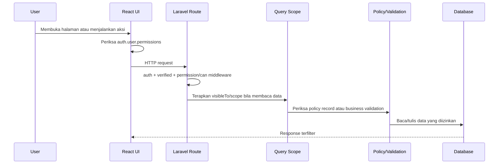

# Dokumentasi Teknis Per Role

> Bagian yang membahas assignment Activity per user sudah tidak berlaku. Gunakan [matriks akses Sub-activity](akses-sub-activity-berdasarkan-role.md).

**PT Ultrajaya Milk Industry & Trading Company Tbk — Internal Ticketing & Reporting**  
Baseline implementasi: 27 Oktober 2026

## 1. Tujuan dan ruang lingkup

Dokumen ini menjelaskan perilaku teknis role bawaan saat ini:

- `SUPER_ADMIN`
- `ADMIN`
- `MANAGER`
- `SUPERVISOR`
- `USER`

Fokus dokumen adalah permission efektif, route, query scope, assignment, policy, UI surface, dan skenario Automated QA. Dokumentasi fitur per modul tersedia pada [Dokumentasi Modul, Fitur, dan Matriks RBAC](modul-fitur-dan-matriks-rbac.md).

> Penting: nama role bukan sumber otorisasi utama. Matriks di bawah adalah konfigurasi awal. Setelah permission role diubah melalui Settings, request berikutnya mengikuti permission terbaru di database.

---

# 2. Arsitektur otorisasi

## 2.1 Sumber konfigurasi

| Komponen | Lokasi | Fungsi |
|---|---|---|
| Katalog permission dan template role | `config/rbac.php` | Mendefinisikan permission resmi dan konfigurasi awal role |
| Seeder role | `database/seeders/RoleSeeder.php` | Membuat permission/role tanpa mereset perubahan mapping existing |
| Route middleware | `routes/web.php` | Menolak akses endpoint tanpa permission/policy |
| Navigation filter | `config/navigation.php` dan `HandleInertiaRequests` | Menentukan menu yang dikirim ke frontend |
| Report query scope | `Report::scopeVisibleTo()` | Membatasi daftar, dashboard, dan export |
| Report record policy | `ReportPolicy` dan `ReportCapabilities` | Mengendalikan view/update/delete/close per record |
| Selection validation | `ReportSelectionScope` | Memvalidasi lokasi/activity ketika membuat atau mengubah report |
| Frontend permission | `auth.user.permissions` | Menyembunyikan atau menampilkan kontrol UI |

## 2.2 Alur pemeriksaan akses



UI bukan boundary keamanan. Menyembunyikan tombol harus selalu disertai middleware, policy, scope, atau validation pada backend.

## 2.3 Perilaku RoleSeeder

- Permission baru dibuat dengan `firstOrCreate`.
- Role baru menerima permission template dari `config/rbac.php`.
- Role existing tidak di-reset ketika seeder dijalankan ulang.
- Perubahan permission yang dilakukan melalui Settings dipertahankan.
- `SUPER_ADMIN` didefinisikan sebagai `['*']` pada config, tetapi tidak menggunakan global `Gate::before`.
- Saat role SUPER_ADMIN pertama dibuat, wildcard diterjemahkan menjadi seluruh record permission.
- Jika permission baru ditambahkan kemudian, reseed menambah permission baru tersebut ke SUPER_ADMIN.

Konsekuensi QA: assertion harus membaca permission aktual database, bukan hanya array config.

---

# 3. SUPER_ADMIN

## 3.1 Profil teknis

| Properti | Nilai |
|---|---|
| Nama role | `SUPER_ADMIN` |
| Model | `Spatie\Permission\Models\Role` |
| Template permission | `*` → seluruh permission katalog |
| Scope report | All |
| Scope Area | All, termasuk archived |
| Proteksi khusus | Akun tidak dapat dihapus; hanya SUPER_ADMIN dapat mengelola akun/role SUPER_ADMIN |

## 3.2 Permission efektif

SUPER_ADMIN menerima seluruh 35 permission yang terdapat dalam katalog:

- seluruh `reports.*`;
- seluruh `areas.*`;
- seluruh `activities.*`;
- seluruh `users.*`;
- `settings.view`;
- seluruh `roles.*`;
- `permissions.manage`.

## 3.3 Route dan capability

| Surface | Akses |
|---|---|
| `/` internal dashboard | Seluruh agregat report |
| `/reports` | Seluruh report |
| Create/update/delete report | Semua report open |
| Close ISSUE | Semua ISSUE open tanpa assignment |
| Export PDF/Excel | Seluruh report sesuai filter |
| `/areas` | Semua Area, termasuk archived |
| Area CRUD/archive/restore/force delete | Diizinkan, tetap mengikuti business validation |
| `/activities` | Seluruh Activity/Sub-activity |
| Activity CRUD/category/assignment | Diizinkan |
| `/settings` | User dan Role |
| User/Role/Permission management | Diizinkan dengan proteksi domain |

## 3.4 Aturan yang tetap membatasi SUPER_ADMIN

Permission penuh tidak melewati aturan berikut:

- REPORT tidak dapat ditutup.
- Report closed tidak dapat diedit, dihapus, atau ditutup kembali.
- Activity yang dipakai report tidak dapat dihapus.
- Activity yang masih memiliki Sub-activity tidak dapat dihapus.
- Sub-activity/Sub-area yang dipakai report tidak dapat dihapus.
- Area dengan report history tidak dapat dihapus permanen.
- System role tidak dapat diubah nama atau dihapus.
- Akun SUPER_ADMIN tidak dapat dihapus, termasuk oleh SUPER_ADMIN lain.
- Akun yang sedang login tidak dapat menghapus dirinya sendiri.

## 3.5 Skenario QA

| ID | Skenario | Expected result |
|---|---|---|
| SA-01 | Buka seluruh menu | Semua menu internal tampil |
| SA-02 | Lihat report user lain | Diizinkan |
| SA-03 | Edit/delete ISSUE open user lain | Diizinkan |
| SA-04 | Close ISSUE tanpa assignment | Diizinkan |
| SA-05 | Close REPORT | `403`/ditolak policy |
| SA-06 | Edit report closed | `403`/ditolak policy |
| SA-07 | Ubah category Sub-activity | Diizinkan |
| SA-08 | Kelola role SUPER_ADMIN | Diizinkan untuk permission, tetapi rename/delete system role tetap ditolak |
| SA-09 | Delete akun SUPER_ADMIN | Ditolak |
| SA-10 | Reseed setelah permission baru | Permission baru ditambahkan tanpa mengembalikan permission lama yang sengaja dicabut pada role lain |

---

# 4. ADMIN

## 4.1 Profil teknis

| Properti | Nilai |
|---|---|
| Nama role | `ADMIN` |
| Scope report | All melalui `reports.view.all`/capability all |
| Scope Area | All melalui `areas.view.all` |
| Tanggung jawab | Operasional master data, assignment, user/role, create/delete/close report |
| Batas utama | Tidak dapat edit isi report secara default; tidak dapat mengelola identitas SUPER_ADMIN |

## 4.2 Permission default

```text
areas.view
areas.view.all
areas.create
areas.edit
areas.delete

activities.view
activities.create
activities.edit
activities.assign.manager
activities.assign.supervisor
activities.delete

users.view
users.create
users.edit
users.delete
users.assign.area
users.promote

reports.view.all
reports.create
reports.export
reports.delete.all
reports.solve.all

settings.view
roles.view
roles.create
roles.edit
roles.delete
permissions.manage
```

ADMIN tidak memperoleh `activities.category.manage`, `reports.edit.own`, atau `reports.edit.all` secara default.

## 4.3 Route dan capability

| Surface | Akses teknis |
|---|---|
| Dashboard | Seluruh data report |
| Reports index/detail/export | Seluruh report |
| Create report | Diizinkan |
| Edit report | Tidak diizinkan secara default |
| Delete report open | Semua report open |
| Close ISSUE open | Semua ISSUE open |
| Area CRUD | Diizinkan |
| View archived Area | Diizinkan |
| Activity/Sub-activity CRUD | Diizinkan |
| Ubah category | Tidak diizinkan; payload category diabaikan/dibatasi |
| Assign reviewer/closer | Diizinkan |
| Settings User/Role | Diizinkan |
| Kelola SUPER_ADMIN | Tidak diizinkan |

## 4.4 Proteksi khusus ADMIN

- Akun SUPER_ADMIN disembunyikan dari daftar user.
- Role SUPER_ADMIN disembunyikan dari pilihan/daftar yang tidak boleh dikelola.
- ADMIN tidak dapat membuat atau mengubah user menjadi SUPER_ADMIN.
- ADMIN tidak dapat mengubah permission role SUPER_ADMIN.
- ADMIN dapat mengelola custom role dan system role permissions selain proteksi SUPER_ADMIN, tetapi tidak dapat rename/delete system role.
- `permissions.manage` tidak otomatis memberikan create/edit/delete role; route tersebut memakai permission terpisah.

## 4.5 Skenario QA

| ID | Skenario | Expected result |
|---|---|---|
| ADM-01 | Dashboard/report seluruh user | Seluruh data terlihat |
| ADM-02 | Edit report open user lain | Ditolak karena tidak memiliki `reports.edit.all` |
| ADM-03 | Delete report open user lain | Diizinkan |
| ADM-04 | Close ISSUE user lain | Diizinkan tanpa assignment |
| ADM-05 | Close REPORT | Ditolak |
| ADM-06 | Ubah category Sub-activity | Input tidak tersedia/perubahan tidak diterapkan |
| ADM-07 | Assign reviewer tanpa permission review | User kandidat ditolak |
| ADM-08 | Assign closer tanpa permission close | User kandidat ditolak |
| ADM-09 | Lihat/edit akun SUPER_ADMIN | Tidak terlihat dan direct mutation ditolak |
| ADM-10 | Create custom role tetapi permission delete dicabut | Create tetap berhasil; delete menghasilkan `403` |

---

# 5. MANAGER

## 5.1 Profil teknis

| Properti | Nilai |
|---|---|
| Nama role | `MANAGER` |
| Scope report | Activity assignment |
| Scope Area page | Area aktif yang terkait sebagai PIC/manager |
| Tanggung jawab | Melihat dan mereview report pada Activity yang ditugaskan |
| Aksi review saat ini | Read-only; belum ada approve/reject/status review |

## 5.2 Permission default

```text
areas.view
activities.view
reports.review.area
reports.export
```

## 5.3 Dependency assignment

MANAGER memerlukan dua jenis mapping yang memiliki fungsi berbeda:

| Mapping | Relasi | Pengaruh |
|---|---|---|
| Area reviewer/PIC | `area_user` melalui `managedAreas()` | Menentukan Area yang muncul pada halaman Area dan validasi selection tertentu |
| Activity reviewer | `activity_managers` melalui `assignedActivities()` | Menentukan report yang dapat dilihat/review |

Pada `Report::scopeVisibleTo()`, visibility report MANAGER ditentukan oleh assignment Activity. Pada `ReportSelectionScope`, kombinasi Area dan Activity digunakan bila role kemudian diberi kemampuan membuat/edit report.

## 5.4 Route dan capability

| Surface | Akses teknis |
|---|---|
| Dashboard | Agregasi report pada assigned Activity |
| Reports index/detail | Report pada assigned Activity |
| Export | Report pada assigned Activity |
| Create/edit/delete report | Tidak diizinkan secara default |
| Close ISSUE | Tidak diizinkan secara default |
| Area page | Area aktif yang terkait assignment |
| Activity page | Dapat melihat seluruh struktur Activity |
| Activity mutation/assignment | Tidak diizinkan |
| Settings | Tidak diizinkan |

## 5.5 Perilaku custom capability

Jika permission MANAGER diubah:

- tambah `reports.create`: Manager dapat membuat report, tetapi selection scope harus sesuai assignment yang dimiliki;
- tambah `reports.solve.own.area`: Manager juga membutuhkan assignment Sub-area dan Sub-activity untuk close;
- tambah `reports.solve.all`: Manager dapat close semua ISSUE tanpa assignment;
- tambah `reports.view.all`: visibility report menjadi seluruh data;
- tambah `activities.assign.*`: aksi assignment dapat tersedia tanpa bergantung pada nama role.

## 5.6 Skenario QA

| ID | Skenario | Expected result |
|---|---|---|
| MGR-01 | Lihat report assigned Activity | Diizinkan |
| MGR-02 | Lihat report Activity lain | Tidak muncul; direct detail ditolak |
| MGR-03 | Export | Hanya report assigned Activity |
| MGR-04 | Create report | Tombol tidak tampil; route `403` |
| MGR-05 | Close ISSUE | Tombol tidak tampil; route `403` |
| MGR-06 | Buka Activity | Diizinkan read-only |
| MGR-07 | Buka Area tanpa assignment | Daftar kosong |
| MGR-08 | Buka Settings | Menu tidak tampil; route `403` |
| MGR-09 | Permission create ditambahkan | Create aktif pada request berikutnya tanpa perubahan kode role |

---

# 6. SUPERVISOR

## 6.1 Profil teknis

| Properti | Nilai |
|---|---|
| Nama role | `SUPERVISOR` |
| Scope report | Own + assigned Sub-area visibility |
| Scope close | Irisan assigned Sub-area dan assigned Sub-activity |
| Scope Area page | Area aktif yang memiliki Sub-area assignment pengguna |
| Tanggung jawab | Membuat report dan menutup ISSUE sesuai penugasan |

## 6.2 Permission default

```text
reports.view.own
reports.create
reports.export
reports.edit.own
reports.delete.own
reports.solve.own.area
areas.view
activities.view
```

## 6.3 Algoritma visibility dan close

Visibility report:

```text
report.author_id == supervisor.id
OR report.sub_area has supervisor assignment
```

Hak close lebih ketat:

```text
report.status == open
AND report.category_snapshot == ISSUE
AND report.sub_area_id is assigned to supervisor
AND report.sub_activity_id is assigned to supervisor
```

Konsekuensinya, Supervisor dapat melihat ISSUE pada Sub-area tugasnya tetapi tombol close hanya muncul bila Sub-activity juga cocok.

## 6.4 Dependency assignment

| Assignment | Pivot/relasi | Fungsi |
|---|---|---|
| Sub-area | `sub_area_user` melalui `supervisedSubAreas()` | Visibility report Sub-area dan syarat close |
| Sub-activity | `sub_activity_supervisors` melalui `assignedSubActivities()` | Syarat close dan selection scope |

## 6.5 Route dan capability

| Surface | Akses teknis |
|---|---|
| Dashboard | Own report + report pada assigned Sub-area |
| Reports index/detail | Own + assigned Sub-area |
| Create report | Diizinkan; selection tunduk pada scope jika applicable |
| Edit/delete | Hanya report sendiri yang open |
| Close ISSUE | Hanya dua assignment cocok |
| Close REPORT | Tidak pernah diizinkan |
| Export | Own + assigned Sub-area visibility |
| Area page | Area aktif yang memiliki Sub-area assignment |
| Activity page | Read-only seluruh struktur |
| Settings | Tidak diizinkan |

## 6.6 Skenario QA

| ID | Skenario | Expected result |
|---|---|---|
| SPV-01 | Lihat report sendiri | Diizinkan |
| SPV-02 | Edit/delete report sendiri yang open | Diizinkan |
| SPV-03 | Edit/delete report sendiri yang closed | Ditolak |
| SPV-04 | Lihat report user lain pada assigned Sub-area | Diizinkan |
| SPV-05 | Close ISSUE dengan dua assignment cocok | Diizinkan |
| SPV-06 | Close ISSUE hanya cocok Sub-area | Ditolak |
| SPV-07 | Close ISSUE hanya cocok Sub-activity | Ditolak |
| SPV-08 | Close ISSUE di luar kedua assignment | Ditolak |
| SPV-09 | Close REPORT dengan assignment cocok | Ditolak |
| SPV-10 | Export | Tidak mengandung report di luar own/assigned Sub-area |
| SPV-11 | Activity dan Area page | Tampil read-only sesuai aturan masing-masing |
| SPV-12 | Settings | `403` |

## 6.7 Pengaturan assignment

Supervisor dapat dibuat sebelum memiliki assignment. Pengguna dengan `users.assign.area` dan akses Area dapat menetapkan beberapa closer melalui menu Sub-area, sesuai permission close. Assignment Sub-activity tetap dilakukan pada halaman Activity. Tanpa kedua assignment, Supervisor tidak dapat menutup ISSUE dalam scope tersebut.

---

# 7. USER

## 7.1 Profil teknis

| Properti | Nilai |
|---|---|
| Nama role | `USER` |
| Scope report | Own |
| Tanggung jawab | Membuat dan mengelola report sendiri selama masih open |
| Scope master data | Tidak dapat membuka Area atau Activity page |

## 7.2 Permission default

```text
reports.view.own
reports.create
reports.export
reports.edit.own
reports.delete.own
```

## 7.3 Route dan capability

| Surface | Akses teknis |
|---|---|
| Dashboard | Hanya agregasi report sendiri |
| Reports index/detail | Hanya report sendiri |
| Create report | Diizinkan |
| Edit/delete | Hanya report sendiri yang open |
| Close ISSUE | Tidak diizinkan |
| Export | Hanya report sendiri |
| Area page | Tidak diizinkan |
| Activity page | Tidak diizinkan |
| Settings | Tidak diizinkan |

USER tetap memperoleh opsi Area/Activity yang diperlukan pada form Report melalui payload ReportController. Permission untuk menggunakan form tidak sama dengan permission membuka halaman master data.

## 7.4 Skenario QA

| ID | Skenario | Expected result |
|---|---|---|
| USR-R01 | Dashboard | Angka hanya berasal dari report sendiri |
| USR-R02 | Create ISSUE/REPORT | Diizinkan sesuai master aktif |
| USR-R03 | Lihat detail report sendiri | Diizinkan |
| USR-R04 | Direct detail report user lain | Ditolak |
| USR-R05 | Edit/delete report sendiri yang open | Diizinkan |
| USR-R06 | Edit/delete report sendiri yang closed | Ditolak |
| USR-R07 | Close ISSUE sendiri | Ditolak |
| USR-R08 | Export | Hanya report sendiri |
| USR-R09 | Buka Area/Activity/Settings | Menu tidak tampil dan route `403` |

---

# 8. Perbandingan teknis antar-role

## 8.1 Page access

| Route/page | SUPER_ADMIN | ADMIN | MANAGER | SUPERVISOR | USER |
|---|---:|---:|---:|---:|---:|
| `/` Dashboard | ✅ | ✅ | ✅ | ✅ | ✅ |
| `/reports` | ✅ | ✅ | ✅ | ✅ | ✅ |
| `/areas` | ✅ | ✅ | 🔒 | 🔒 | — |
| `/activities` | ✅ | ✅ | ✅ | ✅ | — |
| `/settings` | ✅ | ✅ | — | — | — |
| `/dashboard` Public display | Public | Public | Public | Public | Public |

## 8.2 Report capability

| Capability | SUPER_ADMIN | ADMIN | MANAGER | SUPERVISOR | USER |
|---|---:|---:|---:|---:|---:|
| Read scope | All | All | Assigned Activity | Own + assigned Sub-area | Own |
| Create | ✅ | ✅ | — | ✅ | ✅ |
| Edit | Semua open | — | — | Own open | Own open |
| Delete | Semua open | Semua open | — | Own open | Own open |
| Close | Semua open ISSUE | Semua open ISSUE | — | Assigned open ISSUE | — |
| Export | All | All | Assigned Activity | Own + assigned Sub-area | Own |

## 8.3 Master/configuration capability

| Capability | SUPER_ADMIN | ADMIN | MANAGER | SUPERVISOR | USER |
|---|---:|---:|---:|---:|---:|
| Area CRUD | ✅ | ✅ | — | — | — |
| Activity CRUD | ✅ | ✅ | — | — | — |
| Manage category | ✅ | — | — | — | — |
| Assign reviewer/closer | ✅ | ✅ | — | — | — |
| User CRUD | ✅ | ✅ | — | — | — |
| Custom role CRUD | ✅ | ✅ | — | — | — |
| Manage permissions | ✅ | ✅ | — | — | — |
| Manage SUPER_ADMIN identity | ✅ | — | — | — | — |

---

# 9. Role custom dan perubahan permission

## 9.1 Sifat dinamis

Role custom tidak memerlukan conditional baru di kode selama capability sudah memiliki permission yang tersedia. Contoh:

- role `AUDITOR` dengan `reports.view.all` dan `reports.export` menjadi read-only seluruh report;
- role `COORDINATOR` dengan `reports.review.area` mengikuti Activity assignment;
- role `SENIOR_SPV` dengan `reports.solve.own.area` mengikuti Sub-area dan Sub-activity assignment;
- role apa pun dengan `activities.assign.manager` dapat melakukan assignment reviewer jika juga dapat membuka Activity page.

## 9.2 Kombinasi permission yang perlu diuji

| Kombinasi | Expected behavior |
|---|---|
| `settings.view` tanpa `users.view`/`roles.view` | Settings dapat dibuka tetapi tidak menampilkan data tab yang tidak diizinkan |
| `roles.create` tanpa `roles.delete` | Create berhasil, delete `403` |
| `reports.export` tanpa read capability | Export route memiliki permission tetapi query tetap tidak boleh mengembalikan data di luar scope |
| `reports.review.area` tanpa assignment | Reports/dashboard kosong untuk scope review |
| `reports.solve.own.area` tanpa assignment lengkap | Dapat kosong atau read terbatas; close ditolak |
| `activities.edit` tanpa assign permission | CRUD tersedia, assignment tidak tersedia |
| `activities.category.manage` tanpa edit/create | Permission category sendiri tidak menciptakan route mutasi |
| `areas.view.all` tanpa `areas.view` | Menu/route Area tetap tidak tersedia |

## 9.3 Pencabutan permission

- Permission yang dicabut efektif pada request berikutnya.
- Assignment yang sudah tersimpan tidak otomatis dihapus.
- Assignment tanpa permission tidak memberikan capability.
- Jika permission diberikan kembali, assignment lama dapat aktif kembali.
- Automated QA harus menguji revoke → request baru → capability hilang tanpa perlu login ulang jika cache permission sudah dibersihkan oleh flow Settings.

---

# 10. Data dan akun pengujian

## 10.1 Seeder utama

`UserSeeder` membuat akun riil aplikasi dan menetapkan satu role per user. Dokumen ini tidak menduplikasi password atau daftar kredensial. Gunakan data development secara terkendali dan jangan memakai database production untuk Automated QA destruktif.

## 10.2 Database QA terisolasi

Reset database QA lokal/testing:

```bash
php artisan app:reset-rbac-test
```

Menambahkan report uji ke master existing:

```bash
php artisan app:seed-rbac-test
```

Detail isolasi dan data fixture tersedia pada [Seeder Laporan Pengujian](pengujian-rbac.md).

## 10.3 Prinsip fixture per role

Untuk setiap role, minimal sediakan:

- satu report milik sendiri dan satu milik user lain;
- ISSUE open, ISSUE closed, dan REPORT;
- data di dalam scope dan di luar scope;
- assignment lengkap, parsial, dan kosong untuk Manager/Supervisor;
- Area/Activity aktif serta archived/inactive;
- custom role dengan permission parsial untuk membuktikan sistem tidak hardcode berdasarkan nama role.

---

# 11. Mapping test suite yang direkomendasikan

| Area teknis | Test existing | Pengembangan E2E berikutnya |
|---|---|---|
| Role/permission route isolation | `RbacAccessTest` | Login setiap role dan direct URL |
| Report policy | `RbacAccessTest`, `PermissionSurfaceTest` | Tombol vs endpoint per record |
| Scope export | `PermissionSurfaceTest` | Download dan inspeksi PDF/Excel |
| Seeder QA | `RbacAcceptanceSeederTest` | Setup environment browser test |
| Workflow CRUD | `ManagementWorkflowTest` | Modal/form interaction |
| Dashboard scope | `DashboardSummaryTest` | KPI/chart per role dan periode |
| Responsive UI | Belum lengkap | Playwright viewport matrix |
| Assignment Area | `AreaAssignmentTest` | E2E Area → Activity → close ISSUE |

---

# 12. Checklist regresi per perubahan RBAC

Setiap perubahan role atau permission wajib memverifikasi:

1. permission terdapat di katalog config dan database;
2. navigation mengikuti permission halaman;
3. tombol, field, filter, dan action mengikuti permission;
4. direct route menghasilkan status yang benar;
5. list dan detail memakai scope yang sama;
6. dashboard tidak membocorkan agregasi;
7. export tidak memperluas scope;
8. policy record tetap membatasi status/category;
9. assignment kandidat hanya memuat user aktif dengan capability sesuai;
10. reseed tidak mereset konfigurasi role yang sudah diubah.

Dokumen ini menggambarkan role bawaan pada baseline tanggal di atas. Untuk diagnosis akun tertentu, baca permission aktual dengan `getAllPermissions()` dan assignment relation pengguna, bukan hanya nama role.
