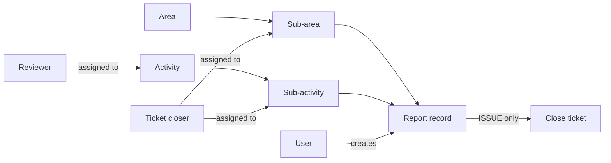
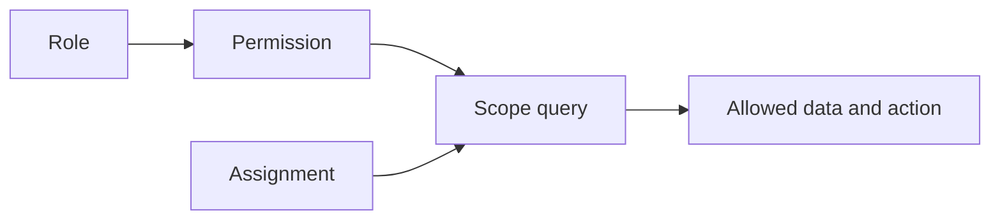

# Dokumentasi Modul, Fitur, dan Matriks RBAC

> Dokumen ini menjelaskan mode assignment per user (default). Untuk mode baru berdasarkan role Sub-activity, termasuk matriks aksi dan langkah transisi, lihat [Akses Sub-activity berdasarkan role](akses-sub-activity-berdasarkan-role.md).

**PT Ultrajaya Milk Industry & Trading Company Tbk — Internal Ticketing & Reporting**  
Versi baseline Automated QA: 27 Oktober 2026

## 1. Tujuan dokumen

Dokumen ini menjadi sumber acuan fungsional sebelum Automated QA dibuat. Cakupannya meliputi:

- fitur pada modul User, Role, Report, Activity, Area, dan Dashboard;
- aturan bisnis dan validasi penting;
- data yang boleh dilihat berdasarkan scope pengguna;
- permission yang mengendalikan UI, route, dan operasi backend;
- matriks role bawaan;
- perilaku role custom dan RBAC dinamis;
- gap implementasi yang harus diperhatikan saat menyusun test.

Matriks pada dokumen ini menggambarkan konfigurasi role bawaan di `config/rbac.php`. Hak aktual tidak ditentukan oleh nama role, melainkan oleh kombinasi **permission**, **scope data**, dan **assignment**.

Pembahasan implementasi route, query scope, policy, assignment, serta skenario QA untuk setiap role tersedia pada [Dokumentasi Teknis Per Role](dokumentasi-teknis-per-role.md).

## 2. Istilah dan legenda

| Simbol | Arti |
|---|---|
| ✅ | Diizinkan oleh konfigurasi role bawaan |
| 🔒 | Diizinkan, tetapi terbatas pada data sendiri atau assignment |
| — | Tidak memiliki permission bawaan |
| Dinamis | Mengikuti permission yang dipilih untuk role custom |

Istilah scope:

| Scope | Penjelasan |
|---|---|
| Own | Data yang dibuat oleh pengguna tersebut |
| All | Seluruh data yang dapat diakses sistem tanpa pembatasan assignment |
| Assigned area | Area atau sub-area yang dipetakan kepada pengguna |
| Assigned activity | Activity yang menetapkan pengguna sebagai reviewer |
| Assigned sub-activity | Sub-activity yang menetapkan pengguna sebagai ticket closer |

## 3. Ringkasan struktur bisnis

Aturan utamanya:

1. Setiap report terkait dengan satu Area, Sub-area, Activity, dan Sub-activity.
2. Kategori ditentukan pada Sub-activity dan disalin ke `category_snapshot` saat report dibuat.
3. `ISSUE` dapat ditutup jika masih terbuka dan pengguna berwenang.
4. `REPORT` adalah catatan observasi dan tidak dapat ditutup.
5. Perubahan kategori Sub-activity tidak mengubah kategori report lama.

---

# 4. Modul User

## 4.1 Tujuan

Modul User mengelola akun, identitas, role, status akses efektif, dan scope lokasi pengguna. Modul ini berada pada halaman Settings tab Users.

## 4.2 Fitur

| ID | Fitur | Perilaku |
|---|---|---|
| USR-01 | Daftar pengguna | Menampilkan nama, email, role, status, dan scope yang tersedia |
| USR-02 | Search | Mencari pengguna berdasarkan nama atau email |
| USR-03 | Filter dan sort | Role, status akun, assignment area, nama, serta waktu penambahan |
| USR-04 | Pagination | Mendukung 10, 25, 50, 100, atau seluruh data |
| USR-05 | Create user | Membuat akun dengan nama, email unik, role, dan password minimal enam karakter |
| USR-06 | Edit user | Mengubah nama, email, password opsional, dan role sesuai permission |
| USR-07 | Delete user | Menghapus pengguna selain akun sendiri dan akun SUPER_ADMIN |
| USR-08 | Assign role | Role dapat diubah hanya dengan `users.promote` |
| USR-09 | Assign reviewer area | Area reviewer dapat dipetakan dengan `users.assign.area` |
| USR-10 | Proteksi SUPER_ADMIN | Hanya SUPER_ADMIN yang dapat membuat, mengubah, atau menetapkan role SUPER_ADMIN |

## 4.3 Validasi dan aturan bisnis

- Email harus unik.
- Password saat create wajib, minimal enam karakter.
- Password saat edit bersifat opsional; nilai kosong mempertahankan password lama.
- Pengguna tidak dapat menghapus akun yang sedang dipakai sendiri.
- Akun SUPER_ADMIN tidak dapat dihapus.
- Pengguna non-SUPER_ADMIN tidak dapat mengubah akun atau menetapkan role SUPER_ADMIN.
- Pengubahan role membutuhkan `users.promote`, terpisah dari `users.edit`.
- Pengubahan scope lokasi membutuhkan `users.assign.area`.
- User dapat dibuat sebelum assignment lokasi; reviewer dan ticket closer ditugaskan kemudian melalui halaman Area.

## 4.4 Matriks role bawaan — User

| Fitur | Permission | Super Admin | Admin | Manager | Supervisor | User |
|---|---|---:|---:|---:|---:|---:|
| Buka Settings | `settings.view` | ✅ | ✅ | — | — | — |
| Lihat daftar user | `users.view` | ✅ | ✅ | — | — | — |
| Create user | `users.create` | ✅ | ✅ | — | — | — |
| Edit data user | `users.edit` | ✅ | ✅ | — | — | — |
| Delete user | `users.delete` | ✅ | ✅ | — | — | — |
| Ubah role user | `users.promote` | ✅ | ✅ | — | — | — |
| Atur scope area | `users.assign.area` | ✅ | ✅ | — | — | — |
| Kelola akun SUPER_ADMIN | Proteksi khusus | ✅ | — | — | — | — |

## 4.5 Acceptance criteria utama

- Tombol dan input yang tidak diizinkan tidak boleh ditampilkan.
- Request langsung ke endpoint tetap harus menghasilkan `403` bila permission tidak ada.
- Admin tidak boleh melihat akun SUPER_ADMIN pada daftar.
- Admin tidak boleh membuat atau mempromosikan user menjadi SUPER_ADMIN.
- Delete akun sendiri dan SUPER_ADMIN harus ditolak oleh backend.
- Perubahan role tidak boleh otomatis memperluas data di luar scope permission dan assignment.

---

# 5. Modul Role

## 5.1 Tujuan

Modul Role mengelola role custom dan kumpulan permission. Role bawaan berfungsi sebagai template default, sedangkan kemampuan aktual tetap mengikuti permission yang tersimpan di database.

## 5.2 Fitur

| ID | Fitur | Perilaku |
|---|---|---|
| ROL-01 | Daftar role | Menampilkan nama, tipe System/Custom, jumlah permission, dan preview grup permission |
| ROL-02 | Search, filter, sort | Nama, sumber role, status konfigurasi permission, dan jumlah permission |
| ROL-03 | Create custom role | Nama role wajib unik |
| ROL-04 | Rename custom role | Hanya role custom yang dapat diganti nama |
| ROL-05 | Delete custom role | Hanya role custom yang tidak sedang dipakai user |
| ROL-06 | Permission editor | Memilih permission per grup atau secara individual |
| ROL-07 | Dynamic capability | Role custom dapat menerima kombinasi permission apa pun dari katalog resmi |

## 5.3 Validasi dan aturan bisnis

- Nama role harus unik.
- Role bawaan `SUPER_ADMIN`, `ADMIN`, `MANAGER`, `SUPERVISOR`, dan `USER` tidak dapat diganti nama atau dihapus.
- Role custom yang masih dimiliki pengguna tidak dapat dihapus.
- Non-SUPER_ADMIN tidak dapat mengubah permission role SUPER_ADMIN.
- Permission yang dikirim harus terdaftar pada katalog `config/rbac.php`.
- Mengubah permission role berlaku pada semua user yang menggunakan role tersebut.
- Seeder permission tidak boleh mengembalikan permission yang sudah dicabut dari role existing.

## 5.4 Matriks role bawaan — Role management

| Fitur | Permission | Super Admin | Admin | Manager | Supervisor | User |
|---|---|---:|---:|---:|---:|---:|
| Lihat role | `roles.view` | ✅ | ✅ | — | — | — |
| Create custom role | `roles.create` | ✅ | ✅ | — | — | — |
| Rename custom role | `roles.edit` | ✅ | ✅ | — | — | — |
| Delete custom role | `roles.delete` | ✅ | ✅ | — | — | — |
| Kelola permission | `permissions.manage` | ✅ | ✅ | — | — | — |
| Ubah permission SUPER_ADMIN | Proteksi khusus | ✅ | — | — | — | — |

## 5.5 Acceptance criteria utama

- System role tidak memiliki aksi Edit/Delete.
- Role custom yang masih digunakan harus gagal dihapus dengan pesan bisnis.
- Pengguna tanpa `permissions.manage` tidak menerima katalog permission dari server.
- UI tersembunyi bukan satu-satunya proteksi; endpoint harus tetap terlindungi middleware.

---

# 6. Modul Report

## 6.1 Tujuan

Modul Report mencatat observasi dan issue lapangan, menyediakan dokumentasi foto, pencarian, filter, detail, penyelesaian issue, serta export.

## 6.2 Fitur daftar dan detail

| ID | Fitur | Perilaku |
|---|---|---|
| REP-01 | Daftar report | Menampilkan data sesuai scope akses pengguna |
| REP-02 | Search | Mencari finding, reporter, activity, dan sub-activity |
| REP-03 | Filter | Periode, category, status ISSUE, area, sub-area, activity, reporter, role, dan foto |
| REP-04 | Sort | Tanggal, finding, area, activity, dan opsi lain yang tersedia pada toolbar |
| REP-05 | Detail report | Reporter/role, lokasi, activity, category, finding, notes, foto, status, dan resolution |
| REP-06 | Create report | Memilih Area, Sub-area, Activity, Sub-activity; mengisi finding dan notes |
| REP-07 | Camera/file upload | Foto dapat diambil dari kamera atau dipilih dari perangkat |
| REP-08 | Image editor | Crop, rotate, annotate, text, dan blur sebelum gambar digunakan |
| REP-09 | Compression/storage | Gambar dioptimalkan dan disimpan dengan struktur nama yang terkelola |
| REP-10 | Edit report | Hanya report terbuka dan sesuai permission own/all |
| REP-11 | Delete report | Hanya report terbuka dan sesuai permission own/all |
| REP-12 | Close ISSUE | Catatan resolution wajib; foto akhir opsional |
| REP-13 | Export Excel | Data detail dan before/after photo mengikuti scope pengguna |
| REP-14 | Export PDF | Data diekspor dalam batch aman dan card tidak terpotong page break |

## 6.3 Data minimum pada detail dan export

PDF dan Excel harus memuat data yang sama secara substantif dengan modal Report Detail:

- reporter dan role reporter;
- Area dan Sub-area;
- Activity dan Sub-activity;
- category (`ISSUE`/`REPORT`);
- finding atau observation;
- additional notes;
- before photo dan after photo;
- status;
- reported at;
- closed at, closed by, role closer, dan resolution bila sudah ditutup.

## 6.4 Aturan kategori dan status

| Category | Status operasional | Dapat ditutup? | Resolution |
|---|---|---:|---|
| ISSUE | Open / Closed | Ya, bila open dan berwenang | Wajib ketika close |
| REPORT | Report | Tidak | Tidak berlaku |

Aturan tambahan:

- Category berasal dari Sub-activity, bukan pilihan bebas di form report.
- Category disimpan sebagai snapshot agar report lama tidak berubah ketika master Sub-activity diubah.
- Report yang closed tidak dapat diedit, dihapus, atau ditutup kembali.
- Tidak ada fitur reopen pada implementasi saat ini.
- Export tidak boleh memperluas scope meskipun filter request dimanipulasi.

## 6.5 Aturan scope report

| Permission | Data yang dapat dilihat |
|---|---|
| `reports.view.all` | Seluruh report |
| `reports.solve.all` | Seluruh report, karena perlu menemukan ISSUE yang dapat ditutup |
| `reports.edit.all` | Seluruh report |
| `reports.delete.all` | Seluruh report |
| `reports.view.own` | Report milik sendiri |
| `reports.create` | Report milik sendiri |
| `reports.edit.own` | Report milik sendiri |
| `reports.delete.own` | Report milik sendiri |
| `reports.review.area` | Report pada Activity yang ditugaskan kepada pengguna |
| `reports.solve.own.area` | Report pada Sub-area yang ditugaskan; aksi close masih memerlukan assignment Sub-activity |

## 6.6 Matriks role bawaan — Report

| Fitur | Permission | Super Admin | Admin | Manager | Supervisor | User |
|---|---|---:|---:|---:|---:|---:|
| Lihat seluruh report | `reports.view.all` atau capability all | ✅ | ✅ | — | — | — |
| Lihat report sendiri | `reports.view.own`/capability own | ✅ | ✅ | — | ✅ | ✅ |
| Review assigned Activity | `reports.review.area` + assignment | ✅ | ✅ | 🔒 | — | — |
| Lihat assigned Sub-area | `reports.solve.own.area` + assignment | ✅ | ✅ | — | 🔒 | — |
| Create report | `reports.create` | ✅ | ✅ | — | ✅ | ✅ |
| Edit report sendiri yang open | `reports.edit.own` | ✅ | — | — | ✅ | ✅ |
| Edit semua report yang open | `reports.edit.all` | ✅ | — | — | — | — |
| Delete report sendiri yang open | `reports.delete.own` | ✅ | — | — | ✅ | ✅ |
| Delete semua report yang open | `reports.delete.all` | ✅ | ✅ | — | — | — |
| Close assigned ISSUE | `reports.solve.own.area` + dua assignment | ✅ | ✅ | — | 🔒 | — |
| Close semua ISSUE | `reports.solve.all` | ✅ | ✅ | — | — | — |
| Close REPORT | Dilarang aturan bisnis | — | — | — | — | — |
| Export | `reports.export` + read scope | ✅ | ✅ | 🔒 | 🔒 | 🔒 |

Catatan: Admin bawaan tidak memiliki `reports.edit.all` atau `reports.edit.own`, sehingga tidak dapat mengubah isi report meskipun dapat membuat, menghapus, dan menutup report.

## 6.7 Acceptance criteria utama

- Policy view, update, delete, dan close harus konsisten antara daftar, detail, tombol, dan endpoint.
- Supervisor hanya dapat close ISSUE jika Sub-area **dan** Sub-activity cocok dengan assignment.
- Manager hanya melihat report pada Activity yang ditugaskan.
- REPORT tidak pernah menampilkan atau menerima aksi close.
- Excel memuat kedua gambar pada kolom terpisah.
- PDF menjaga card utuh dan memiliki top spacing setelah page break.
- Filter export harus divalidasi dan tetap tunduk pada scope pengguna.

---

# 7. Modul Activity

## 7.1 Tujuan

Modul Activity mengelola struktur dua tingkat Activity → Sub-activity, category, status, jumlah report, reviewer, dan ticket closer.

## 7.2 Fitur

| ID | Fitur | Perilaku |
|---|---|---|
| ACT-01 | Hierarchical list | Activity dapat di-expand untuk melihat Sub-activity |
| ACT-02 | Search | Mencari nama/deskripsi Activity dan Sub-activity |
| ACT-03 | Pagination/filter/sort | Jumlah data, nama, jumlah Sub-activity, report, status, dan assignment |
| ACT-04 | Create Activity | Nama unik, deskripsi opsional, status aktif |
| ACT-05 | Edit Activity | Mengubah nama, deskripsi, atau status; tidak mengatur assignee di form ini |
| ACT-06 | Add Sub-activity | Hanya pada Activity aktif |
| ACT-07 | Edit Sub-activity | Nama/deskripsi dapat diubah; tidak dapat dipindah ke Activity lain |
| ACT-08 | Category | Sub-activity memiliki category ISSUE atau REPORT, default ISSUE |
| ACT-09 | Assign reviewer | User harus aktif dan memiliki `reports.review.area` |
| ACT-10 | Assign ticket closer | User harus aktif dan memiliki `reports.solve.own.area` atau `reports.solve.all` |
| ACT-11 | Status | Activity dapat diaktifkan/nonaktifkan; status Sub-activity mengikuti parent |
| ACT-12 | Delete | Hanya master yang belum dipakai report dan memenuhi aturan dependensi |

## 7.3 Validasi dan aturan bisnis

- Nama Activity unik pada data yang belum dihapus.
- Nama Sub-activity unik di dalam satu Activity.
- Hierarki hanya dua tingkat; Activity tidak memiliki parent dan Sub-activity tidak memiliki child.
- Category hanya berada pada Sub-activity.
- Pengguna tanpa `activities.category.manage` tidak dapat mengubah category; create menggunakan default ISSUE.
- `activities.edit` tidak otomatis mengizinkan assignment.
- Reviewer assignment membutuhkan `activities.assign.manager`.
- Ticket closer assignment membutuhkan `activities.assign.supervisor`.
- Activity yang sudah digunakan report tidak dapat dihapus.
- Activity yang masih memiliki Sub-activity tidak dapat dihapus.
- Sub-activity yang sudah digunakan report tidak dapat dihapus.

## 7.4 Matriks role bawaan — Activity

| Fitur | Permission | Super Admin | Admin | Manager | Supervisor | User |
|---|---|---:|---:|---:|---:|---:|
| Lihat Activity | `activities.view` | ✅ | ✅ | ✅ | ✅ | — |
| Create Activity | `activities.create` | ✅ | ✅ | — | — | — |
| Edit/status Activity | `activities.edit` | ✅ | ✅ | — | — | — |
| Add/edit Sub-activity | `activities.edit` | ✅ | ✅ | — | — | — |
| Kelola category | `activities.category.manage` | ✅ | — | — | — | — |
| Assign reviewer | `activities.assign.manager` | ✅ | ✅ | — | — | — |
| Assign ticket closer | `activities.assign.supervisor` | ✅ | ✅ | — | — | — |
| Delete Activity/Sub-activity | `activities.delete` | ✅ | ✅ | — | — | — |

## 7.5 Acceptance criteria utama

- Pengguna view-only tidak menerima tombol create/edit/delete/assignment.
- Request assignment harus menolak user nonaktif atau user tanpa permission operasional yang sesuai.
- Category input hanya tampil dan diproses bila `activities.category.manage` tersedia.
- Sub-activity yang tidak berada di bawah Activity pada URL harus menghasilkan `404`.

---

# 8. Modul Area

## 8.1 Tujuan

Modul Area mengelola struktur Area → Sub-area, PIC/reviewer area, supervisor Sub-area, dan lifecycle archive/restore/delete.

## 8.2 Fitur

| ID | Fitur | Perilaku |
|---|---|---|
| ARE-01 | Hierarchical list | Area dapat di-expand untuk melihat Sub-area dan assignee |
| ARE-02 | Search | Mencari nama Area |
| ARE-03 | Pagination/filter/sort | Mendukung 10, 25, 50, 100, atau seluruh data |
| ARE-04 | Create Area | Membuat Area aktif dan otomatis membuat Sub-area `General` |
| ARE-05 | Edit Area | Mengubah nama Area |
| ARE-06 | Add/Edit Sub-area | Nama unik dalam Area |
| ARE-07 | Delete Sub-area | Hanya bila belum memiliki report |
| ARE-08 | Archive Area | Soft delete untuk mempertahankan riwayat |
| ARE-09 | Restore Area | Mengaktifkan kembali Area yang archived |
| ARE-10 | Permanent delete | Hanya bila Area tidak memiliki report history |
| ARE-11 | Scoped visibility | Tanpa `areas.view.all`, hanya Area aktif yang terkait PIC/Sub-area assignment pengguna |
| ARE-12 | Assign reviewer | Menu Area mengatur pengguna dengan permission `reports.review.area` |
| ARE-13 | Assign ticket closer | Menu Sub-area mengatur satu atau lebih pengguna dengan permission close |

## 8.3 Validasi dan aturan bisnis

- Nama Area unik pada data aktif/non-archived.
- Create Area selalu membuat Sub-area awal bernama `General`.
- Nama Sub-area unik di dalam Area.
- Jumlah ticket closer per Sub-area tidak dibatasi oleh `max_personnel`; kolom lama dipertahankan untuk kompatibilitas.
- Sub-area yang memiliki report tidak dapat dihapus.
- Area dengan report history tidak dapat dihapus permanen.
- `areas.view.all` tetap memerlukan `areas.view` untuk membuka halaman.

## 8.4 Matriks role bawaan — Area

| Fitur | Permission | Super Admin | Admin | Manager | Supervisor | User |
|---|---|---:|---:|---:|---:|---:|
| Buka halaman Area | `areas.view` | ✅ | ✅ | 🔒 | 🔒 | — |
| Lihat semua termasuk archive | `areas.view.all` | ✅ | ✅ | — | — | — |
| Create Area | `areas.create` | ✅ | ✅ | — | — | — |
| Edit Area/Sub-area | `areas.edit` | ✅ | ✅ | — | — | — |
| Assign reviewer/closer | `users.assign.area` + `areas.view` | ✅ | ✅ | — | — | — |
| Archive/restore/permanent delete | `areas.delete` | ✅ | ✅ | — | — | — |

## 8.5 Acceptance criteria utama

- Manager/Supervisor hanya melihat Area aktif yang berhubungan dengan assignment mereka.
- User tanpa `areas.view` tidak melihat menu dan mendapat `403` jika mengakses route.
- Archive tidak menghapus report history.
- Permanent delete ditolak bila report history ditemukan.
- Sub-area pada URL harus benar-benar milik Area tersebut.

---

# 9. Modul Dashboard

## 9.1 Dashboard internal (`/`)

Dashboard internal tersedia untuk semua pengguna terautentikasi dan seluruh data mengikuti scope report pengguna.

## 9.2 Fitur

| ID | Fitur | Perilaku |
|---|---|---|
| DSH-01 | Period filter | Today, last 7 days, this month, last month, last 90 days, custom, dan all |
| DSH-02 | Custom date range | Tanggal akhir tidak boleh sebelum tanggal mulai |
| DSH-03 | KPI | Total records, REPORT, open ISSUE, dan closed ISSUE |
| DSH-04 | Recent tickets | Maksimal 20 report terbaru pada scope pengguna |
| DSH-05 | Status breakdown | Komposisi REPORT, open ISSUE, dan closed ISSUE |
| DSH-06 | Tickets by Area | Agregasi report per Area |
| DSH-07 | Top Activities | Agregasi report per Activity |
| DSH-08 | Sub-activity analysis | Agregasi report per Sub-activity |
| DSH-09 | Ticket trend | Tren harian dalam periode yang dipilih |
| DSH-10 | Closer performance | Jumlah ISSUE closed per closer |
| DSH-11 | Attention tickets | ISSUE open tertua yang relevan dengan capability close pengguna |

## 9.3 Matriks role bawaan — Dashboard internal

| Data dashboard | Super Admin | Admin | Manager | Supervisor | User |
|---|---:|---:|---:|---:|---:|
| Membuka dashboard | ✅ | ✅ | ✅ | ✅ | ✅ |
| Agregasi seluruh report | ✅ | ✅ | — | — | — |
| Agregasi assigned Activity | ✅ | ✅ | 🔒 | — | — |
| Agregasi assigned Sub-area | ✅ | ✅ | — | 🔒 | — |
| Agregasi report sendiri | ✅ | ✅ | Sesuai permission | ✅ | ✅ |
| Attention ticket untuk close | ✅ | ✅ | — | 🔒 | — |

Dashboard tidak mempunyai permission halaman khusus. Query menggunakan scope report yang sama dengan modul Report. Pengguna yang tidak mempunyai capability membaca report tetap dapat membuka halaman, tetapi tidak memperoleh data report internal.

## 9.4 Dashboard publik (`/dashboard`)

- Dapat diakses tanpa login.
- Terpisah dari dashboard internal.
- Ditujukan untuk display publik dan tidak menggunakan role matrix pengguna internal.
- Automated QA harus menguji route publik dan internal sebagai dua produk tampilan yang berbeda.

## 9.5 Acceptance criteria utama

- Angka KPI harus konsisten dengan filter periode dan scope pengguna.
- REPORT tidak boleh dihitung sebagai open atau closed ISSUE.
- Semua chart, recent tickets, dan breakdown harus berasal dari query scope yang sama.
- Pengguna tidak boleh memperoleh agregat yang membocorkan jumlah report di luar scope.

---

# 10. Modul RBAC Dinamis

## 10.1 Prinsip

Sistem menggunakan RBAC dinamis berbasis Spatie Permission. Nama role bukan pemeriksaan utama dalam operasi bisnis. Otorisasi terdiri dari tiga lapisan:

1. **Role** mengelompokkan permission.
2. **Permission** menentukan capability.
3. **Scope dan assignment** menentukan record yang dapat dilihat atau ditindak.
4. **Business rule** tetap dapat melarang tindakan, misalnya REPORT tidak dapat ditutup.

## 10.2 Matriks role bawaan lengkap

| Permission | Super Admin | Admin | Manager | Supervisor | User |
|---|---:|---:|---:|---:|---:|
| `reports.view.own` | ✅ | — | — | ✅ | ✅ |
| `reports.view.all` | ✅ | ✅ | — | — | — |
| `reports.create` | ✅ | ✅ | — | ✅ | ✅ |
| `reports.export` | ✅ | ✅ | ✅ | ✅ | ✅ |
| `reports.edit.own` | ✅ | — | — | ✅ | ✅ |
| `reports.edit.all` | ✅ | — | — | — | — |
| `reports.delete.own` | ✅ | — | — | ✅ | ✅ |
| `reports.delete.all` | ✅ | ✅ | — | — | — |
| `reports.solve.own.area` | ✅ | — | — | ✅ | — |
| `reports.solve.all` | ✅ | ✅ | — | — | — |
| `reports.review.area` | ✅ | — | ✅ | — | — |
| `areas.view` | ✅ | ✅ | ✅ | ✅ | — |
| `areas.view.all` | ✅ | ✅ | — | — | — |
| `areas.create` | ✅ | ✅ | — | — | — |
| `areas.edit` | ✅ | ✅ | — | — | — |
| `areas.delete` | ✅ | ✅ | — | — | — |
| `activities.view` | ✅ | ✅ | ✅ | ✅ | — |
| `activities.create` | ✅ | ✅ | — | — | — |
| `activities.edit` | ✅ | ✅ | — | — | — |
| `activities.category.manage` | ✅ | — | — | — | — |
| `activities.assign.manager` | ✅ | ✅ | — | — | — |
| `activities.assign.supervisor` | ✅ | ✅ | — | — | — |
| `activities.delete` | ✅ | ✅ | — | — | — |
| `settings.view` | ✅ | ✅ | — | — | — |
| `users.view` | ✅ | ✅ | — | — | — |
| `users.create` | ✅ | ✅ | — | — | — |
| `users.edit` | ✅ | ✅ | — | — | — |
| `users.delete` | ✅ | ✅ | — | — | — |
| `users.assign.area` | ✅ | ✅ | — | — | — |
| `users.promote` | ✅ | ✅ | — | — | — |
| `roles.view` | ✅ | ✅ | — | — | — |
| `roles.create` | ✅ | ✅ | — | — | — |
| `roles.edit` | ✅ | ✅ | — | — | — |
| `roles.delete` | ✅ | ✅ | — | — | — |
| `permissions.manage` | ✅ | ✅ | — | — | — |

SUPER_ADMIN menggunakan wildcard `*`, sehingga otomatis menerima permission katalog yang tersedia.

## 10.3 Permission dependency

| Capability | Permission utama | Dependency/scope |
|---|---|---|
| Buka Reports | Salah satu permission report | Query tetap mengikuti scope |
| Export | `reports.export` | Harus memiliki read scope; export tidak memperluas scope |
| Review Activity | `reports.review.area` | User harus di-assign pada Activity |
| Close assigned ISSUE | `reports.solve.own.area` | User harus di-assign pada Sub-area dan Sub-activity |
| Close all ISSUE | `reports.solve.all` | Tidak membutuhkan assignment |
| Manage category | `activities.category.manage` | Juga membutuhkan create/edit untuk melakukan mutasi terkait |
| Assign reviewer | `activities.assign.manager` | `activities.view` dibutuhkan untuk membuka halaman |
| Assign closer | `activities.assign.supervisor` | `activities.view` dibutuhkan untuk membuka halaman |
| Manage users | Permission `users.*` | `settings.view` dibutuhkan untuk membuka Settings |
| Manage roles | Permission `roles.*`/`permissions.manage` | `settings.view` dibutuhkan untuk membuka Settings |
| View archived Area | `areas.view.all` | `areas.view` dibutuhkan untuk membuka halaman |

## 10.4 Role custom

Role custom dapat menggunakan permission yang sama tanpa perubahan kode. Contoh:

| Role custom | Permission | Assignment | Hasil |
|---|---|---|---|
| Coordinator | `reports.review.area`, `reports.export`, `activities.view` | Activity A dan B | Melihat/review serta export report Activity A dan B |
| Senior SPV | `reports.solve.own.area`, `reports.create`, `activities.view`, `areas.view` | Sub-area X dan Sub-activity Y | Membuat report dan close ISSUE yang cocok dengan dua assignment |
| Auditor | `reports.view.all`, `reports.export` | Tidak diperlukan | Read-only seluruh report dan export |

Penambahan capability yang sudah tersedia cukup dilakukan melalui permission dan assignment. Fitur baru yang belum ada tetap membutuhkan implementasi serta permission baru.

## 10.5 Enforcement berlapis

Automated QA harus memverifikasi semua lapisan berikut:

1. **Navigation** — menu hanya tampil jika permission halaman sesuai.
2. **UI controls** — button, field, filter, dan export hanya tampil jika diizinkan.
3. **Route middleware** — direct request tanpa permission menghasilkan `403`.
4. **Policy** — akses record Report diverifikasi per record.
5. **Query scope** — list, dashboard, filter option, dan export tidak membocorkan data.
6. **Validation** — payload ilegal, relasi parent-child salah, dan assignment invalid ditolak.
7. **Business rules** — aturan domain tetap berlaku meskipun pengguna memiliki permission luas.

## 10.6 Proteksi khusus

- Akun SUPER_ADMIN tidak dapat dihapus.
- Non-SUPER_ADMIN tidak dapat mengelola akun/role SUPER_ADMIN.
- System role tidak dapat diubah nama atau dihapus.
- Custom role yang masih dipakai tidak dapat dihapus.
- Report closed tidak dapat diedit/dihapus/ditutup kembali.
- REPORT tidak dapat ditutup oleh role mana pun.
- Pengguna assignment harus aktif dan memiliki permission operasional yang relevan.

---

# 11. Gap implementasi sebelum Automated QA

## Assignment lokasi untuk ticket closer

Assignment reviewer Area dan ticket closer Sub-area tersedia melalui menu action pada halaman Area. Assignment Sub-activity tetap dilakukan pada halaman Activity. Keduanya diperlukan untuk menutup ISSUE dengan `reports.solve.own.area`; QA perlu menguji alur Area → Activity → close ISSUE untuk beberapa closer.

## GAP-02 — Konsistensi bahasa response backend

Sebagian response/error `SettingController` masih berbahasa Indonesia, sementara UI Settings sudah menggunakan bahasa Inggris. Tentukan satu standar sebelum snapshot/text assertion E2E dibuat.

---

# 12. Rekomendasi urutan Automated QA

1. Authentication dan route protection.
2. Seed role/permission dan validasi matriks RBAC.
3. User dan Role CRUD beserta proteksi SUPER_ADMIN.
4. Area/Sub-area CRUD, archive, restore, dan delete validation.
5. Activity/Sub-activity CRUD, category, hierarchy, dan assignment.
6. Report create/edit/delete dengan scope own/all.
7. ISSUE close dengan kombinasi assignment positif dan negatif.
8. REPORT non-closable.
9. Filter, pagination, sort, dan permission-aware UI controls.
10. Dashboard aggregation tanpa kebocoran scope.
11. Excel/PDF content, photo, filter, batching, dan page-break.
12. Responsive E2E pada 320, 375, 390, 430, 768, 1024, dan 1440 px.

Dokumen ini harus diperbarui setiap kali permission, assignment, business rule, atau surface UI berubah. Automated test harus merujuk ID fitur pada dokumen ini agar traceability antara requirement dan test tetap terjaga.
