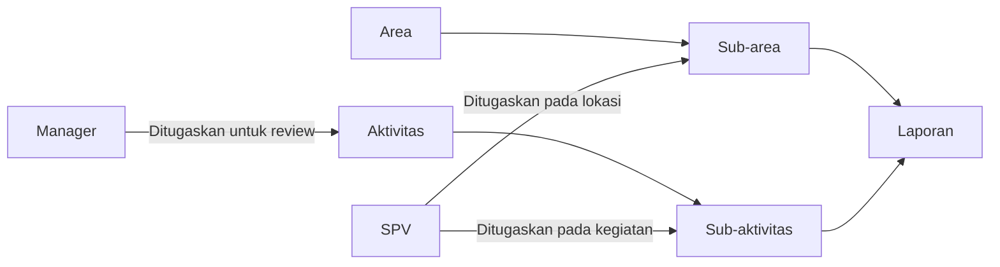
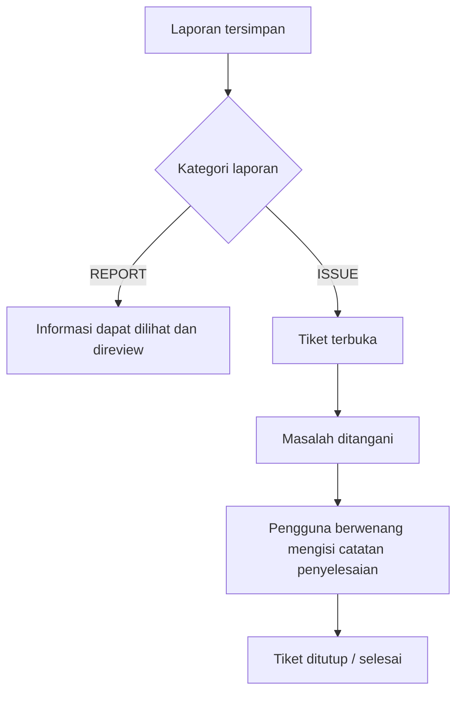

# Panduan Sistem dan Hak Akses Pengguna

**PT Ultrajaya — Internal Ticketing & Reporting**  
Versi dokumentasi: 1.0 · 26 Oktober 2026

Dokumen ini menjelaskan struktur sistem, alur penggunaan, penugasan, dan hak akses pada implementasi aplikasi saat ini. Ditujukan untuk Super Admin, Admin, Manager, Supervisor (SPV), dan User.

## 1. Tujuan sistem

Aplikasi digunakan untuk melaporkan kondisi lapangan, mendokumentasikan temuan, serta menyelesaikan masalah melalui tiket. Laporan dicatat berdasarkan lokasi dan jenis kegiatan agar dapat dipantau oleh penanggung jawab yang sesuai.

Sistem membedakan dua jenis pelaporan:

| Kategori | Kegunaan | Contoh | Dapat ditutup? |
|---|---|---|---|
| ISSUE | Temuan masalah yang membutuhkan penanganan | Mesin bermasalah, fasilitas rusak, perilaku tidak aman | Ya, oleh pengguna yang berwenang |
| REPORT | Informasi atau hasil observasi lapangan | Area bersih, fasilitas rapi, perilaku baik | Tidak |

Kategori ditentukan pada **Sub-aktivitas**, bukan dipilih bebas saat membuat laporan. Sub-aktivitas baru menggunakan kategori ISSUE jika pengguna dengan izin pengaturan kategori tidak menentukan kategori lainnya. Secara bawaan, izin pengaturan kategori diberikan kepada Super Admin.

## 2. Struktur sistem

| Komponen | Pengertian | Contoh |
|---|---|---|
| Area | Kelompok lokasi operasional | TPS |
| Sub-area | Lokasi spesifik di dalam Area | TPS Area Luar |
| Aktivitas | Kelompok kegiatan atau jenis temuan | Behavior Based Safety |
| Sub-aktivitas | Kegiatan spesifik dengan kategori REPORT atau ISSUE | Good Behaviour, Bad Behaviour |
| Laporan | Catatan pengguna pada satu Sub-area dan satu Sub-aktivitas | Hasil observasi beserta dokumentasi |

Satu Area dapat memiliki beberapa Sub-area. Satu Aktivitas dapat memiliki beberapa Sub-aktivitas. Hierarki Aktivitas dibatasi dua tingkat.

Nama contoh bersifat ilustrasi. Kategori setiap Sub-aktivitas mengikuti pengaturan Super Admin.

## 3. Role, izin, dan penugasan

Akses pengguna dipengaruhi tiga hal:

1. **Role**: kelompok pengguna, seperti Manager atau SPV.
2. **Permission/izin**: tindakan yang diizinkan, seperti membuat laporan atau mengatur penugasan.
3. **Penugasan**: lokasi atau Aktivitas/Sub-aktivitas yang menjadi tanggung jawab pengguna.

Memiliki izin mengubah Aktivitas tidak otomatis memberi izin menugaskan Manager atau SPV. Kedua izin penugasan diatur secara terpisah.

Nama role tidak membatasi kemampuan operasional. Manager dapat diberi izin membuat/menutup laporan, dan role custom dapat ditugaskan sebagai reviewer atau penutup tiket. Tabel di bawah merupakan konfigurasi bawaan. Lihat [Panduan pengaturan permission dinamis](rbac-dinamis.md) untuk menyesuaikannya.

### Tanggung jawab role

| Role | Tanggung jawab utama |
|---|---|
| Super Admin | Mengelola konfigurasi sistem, kategori Sub-aktivitas, pengguna, dan hak akses |
| Admin | Mengelola operasional, data master, pengguna, penugasan, serta menangani laporan sesuai izin |
| Manager | Memantau dan mereview laporan pada Aktivitas yang ditugaskan |
| SPV | Membuat laporan dan menyelesaikan ISSUE sesuai penugasan Sub-area dan Sub-aktivitas |
| User | Membuat serta mengelola laporan sendiri yang masih terbuka |

### Matriks akses halaman

Matriks berikut adalah **hak akses bawaan**, berdasarkan konfigurasi role aplikasi. Permission role dapat disesuaikan melalui Pengaturan; akses akun setelah penyesuaian mengikuti konfigurasi terbaru.

| Halaman | Super Admin | Admin | Manager | SPV | User |
|---|---|---|---|---|---|
| Dashboard internal | Ya | Ya | Ya | Ya | Ya |
| Laporan | Seluruh laporan | Seluruh laporan | Aktivitas tugasnya | Sendiri dan Sub-area tugasnya | Sendiri |
| Area | Ya | Ya | Lihat | Lihat | Tidak |
| Aktivitas | Ya | Ya | Lihat | Lihat | Tidak |
| Pengaturan pengguna dan role | Ya | Ya | Tidak | Tidak | Tidak |

Dashboard internal dan menu aplikasi memerlukan login. Angka dan daftar pada dashboard internal mengikuti cakupan akses akun. Aplikasi juga menyediakan dashboard publik pada `/dashboard`, yang dapat diakses tanpa login; jangan menyamakannya dengan dashboard internal.

### Matriks tindakan laporan

| Tindakan | Super Admin | Admin | Manager | SPV | User |
|---|---|---|---|---|---|
| Membuat laporan | Ya | Ya | Tidak | Ya | Ya |
| Melihat seluruh laporan | Ya | Ya | Tidak | Tidak | Tidak |
| Melihat/review laporan Aktivitas tugasnya | Ya | Ya | Ya | Sesuai cakupan SPV | Hanya milik sendiri |
| Mengubah laporan terbuka | Semua | Tidak secara bawaan | Tidak | Milik sendiri | Milik sendiri |
| Menghapus laporan terbuka | Semua | Semua | Tidak | Milik sendiri | Milik sendiri |
| Menutup ISSUE terbuka | Semua | Semua | Tidak | Sub-area **dan** Sub-aktivitas tugasnya | Tidak |
| Menutup REPORT | Tidak | Tidak | Tidak | Tidak | Tidak |
| Mengubah/menghapus laporan selesai | Tidak | Tidak | Tidak | Tidak | Tidak |
| Ekspor Excel/PDF | Seluruh cakupan | Seluruh cakupan | Laporan yang dapat diakses | Laporan yang dapat diakses | Laporan sendiri |

Catatan:

- Admin bawaan memiliki izin membuat, menghapus, dan menutup laporan, tetapi tidak memiliki izin mengubah isi laporan. Jika diperlukan, pengelola permission dapat menambahkan izin tersebut.
- Pengguna dengan izin close sesuai penugasan dapat melihat daftar laporan pada Sub-area tugasnya meskipun belum ditugaskan pada semua Sub-aktivitas di sana. Hak **menutup** lebih terbatas: kedua penugasan harus terpenuhi. Aturan ini berlaku untuk SPV, Manager, maupun role custom dengan permission tersebut.
- Review Manager saat ini berarti melihat dan memeriksa laporan. Belum ada tindakan persetujuan/penolakan atau status approval terpisah.
- Hak ekspor mengikuti cakupan laporan yang diperbolehkan oleh sistem; pemilihan filter tidak memperluas akses.
- Ekspor juga memerlukan permission `reports.export`. Matriks bawaan memberikan izin ini pada kelima role; role custom harus diberikan izin tersebut jika membutuhkan ekspor.

### Matriks pengelolaan data dan konfigurasi

| Tindakan | Super Admin | Admin | Manager | SPV | User |
|---|---|---|---|---|---|
| Tambah/ubah/nonaktifkan Aktivitas | Ya | Ya | Tidak | Tidak | Tidak |
| Tambah/ubah Sub-aktivitas | Ya | Ya | Tidak | Tidak | Tidak |
| Hapus Aktivitas/Sub-aktivitas yang belum digunakan | Ya | Ya | Tidak | Tidak | Tidak |
| Menentukan/mengubah kategori Sub-aktivitas | Ya | Tidak | Tidak | Tidak | Tidak |
| Menugaskan Manager pada Aktivitas | Ya | Ya | Tidak | Tidak | Tidak |
| Menugaskan SPV pada Sub-aktivitas | Ya | Ya | Tidak | Tidak | Tidak |
| Kelola Area dan Sub-area | Ya | Ya | Tidak | Tidak | Tidak |
| Kelola pengguna dan cakupan lokasinya | Ya | Ya, dengan pembatasan akun Super Admin | Tidak | Tidak | Tidak |
| Buat/ubah/hapus role custom | Ya | Ya | Tidak | Tidak | Tidak |
| Mengatur permission role | Ya | Ya, dengan pembatasan role Super Admin | Tidak | Tidak | Tidak |
| Mengubah akun/menetapkan role Super Admin | Ya | Tidak | Tidak | Tidak | Tidak |

Role sistem bawaan tidak dapat diganti nama atau dihapus. Role custom yang masih digunakan juga tidak dapat dihapus. Akun sendiri yang sedang dipakai serta akun Super Admin tidak dapat dihapus melalui pengelolaan pengguna.

## 4. Alur persiapan oleh pengelola

1. Siapkan Area dan Sub-area.
2. Buat Aktivitas, lalu tambahkan Sub-aktivitas dari Aktivitas terkait.
3. Pengguna dengan izin mengatur kategori menentukan kategori setiap Sub-aktivitas; secara bawaan Super Admin.
4. Buat akun pengguna dan pilih role yang sesuai.
5. Untuk pengguna dengan izin review, tentukan minimal satu Area pada Pengaturan Pengguna.
6. Di halaman Area, gunakan menu Sub-area untuk menugaskan satu atau lebih pengguna dengan izin close.
7. Di halaman Aktivitas, buka menu titik tiga Aktivitas dan pilih **Atur reviewer** untuk menugaskan pengguna dengan izin review.
8. Di menu titik tiga Sub-aktivitas, pilih **Atur penutup tiket** untuk menugaskan pengguna dengan izin close.

Satu Aktivitas dapat ditangani beberapa reviewer, dan satu Sub-aktivitas dapat ditangani beberapa penutup tiket. Satu pengguna dapat menerima kedua jenis tugas, termasuk pengguna dengan role custom.

Mapping lokasi dan mapping kegiatan adalah dua pengaturan berbeda. Area Manager pada profil tetap diperlukan saat pengaturan akun, sedangkan cakupan review laporan saat ini ditentukan oleh penugasan Manager pada Aktivitas. Bagi SPV, penugasan lokasi dan Sub-aktivitas bersama-sama menentukan hak close.

### Contoh penugasan

SPV Andi ditugaskan pada Sub-area **TPS Area Luar** dan Sub-aktivitas **Bad Behaviour**:

| Laporan | Boleh ditutup Andi? | Alasan |
|---|---|---|
| ISSUE Bad Behaviour di TPS Area Luar | Ya, jika terbuka | Kedua penugasan sesuai |
| ISSUE Bad Behaviour di Sub-area lain | Tidak | Lokasi tidak sesuai |
| ISSUE pada Sub-aktivitas lain di TPS Area Luar | Tidak | Sub-aktivitas tidak sesuai |
| REPORT di TPS Area Luar | Tidak | REPORT tidak memiliki aksi close |
| ISSUE sesuai tugas tetapi sudah selesai | Tidak | Tiket sudah ditutup |

Contoh ini mengasumsikan Andi memiliki permission close untuk cakupan SPV.

## 5. Membuat laporan

1. Buka **Laporan**, lalu pilih **Buat Laporan** atau tombol tambah pada ponsel.
2. Periksa identitas pelapor. Sistem mengisinya dari akun yang login.
3. Pilih Area dan Sub-area.
4. Pilih Aktivitas dan Sub-aktivitas. Pilihan mengikuti cakupan akun; Sub-aktivitas wajib diisi.
5. Isi **Kendala** untuk ISSUE, atau **Keterangan laporan** untuk REPORT.
6. Isi **Catatan tambahan** bila diperlukan.
7. Tambahkan foto melalui **Ambil foto** atau **Pilih file**, bila diperlukan.
8. Periksa isi dan dokumentasi, lalu pilih **Kirim laporan**.

Nama file dan ukuran hasil editor ditampilkan pada pratinjau foto baru. Foto dapat dipangkas, diputar, diberi penanda atau teks, serta disamarkan sebelum digunakan. Sistem mengoptimalkan foto sebelum disimpan.

Kamera memerlukan izin browser. Untuk akses melalui alamat jaringan/production, gunakan HTTPS. Bila perangkat tidak memiliki kamera atau aksesnya ditolak, gunakan Pilih file.

### Perubahan kategori

Kategori laporan dicatat saat laporan dibuat. Contoh: laporan dibuat ketika Sub-aktivitas berkategori REPORT; jika kategorinya kemudian diubah menjadi ISSUE, laporan lama tetap REPORT dan tidak bisa ditutup.

Jika pengguna berwenang mengubah laporan terbuka dan memilih **Sub-aktivitas lain**, kategori laporan mengikuti Sub-aktivitas baru tersebut.

## 6. Memantau, mencari, dan memfilter

Dashboard menampilkan ringkasan sesuai cakupan akun. Pilih periode yang tersedia atau isi tanggal mulai dan akhir untuk memantau rentang tertentu.

Pada halaman Laporan:

- Gunakan pencarian untuk menemukan isi laporan, pelapor, atau Aktivitas/Sub-aktivitas.
- Buka **Filter laporan** untuk mengatur periode, urutan, status, Area, Sub-area, Aktivitas, dan kelengkapan foto.
- Pilihan pelapor dan peran pembuat tersedia bagi akun dengan akses seluruh laporan.
- Area, Sub-area, Aktivitas, status, pelapor, dan peran mendukung pemilihan beberapa nilai bila kontrolnya tersedia.
- Pilih **Terapkan** untuk mengaktifkan perubahan filter. Menutup filter tanpa menerapkan tetap mempertahankan filter aktif sebelumnya.
- **Atur ulang** membersihkan pilihan sementara; pilih Terapkan untuk menggunakan hasil reset.
- Gunakan **Ekspor** untuk mengunduh Excel atau PDF, lalu atur kriteria ekspor pada form yang tersedia.

Pengaturan ekspor dipilih melalui form ekspor. Jangan mengasumsikan seluruh filter daftar otomatis disalin ke form tersebut.

## 7. Memeriksa detail dan menyelesaikan ISSUE

Pilih laporan untuk membuka detail identitas pelapor, lokasi, Aktivitas/Sub-aktivitas, isi, foto, dan informasi penyelesaian bila sudah ditutup.

Untuk menutup ISSUE:

1. Pastikan masalah sudah ditangani.
2. Buka detail laporan dan pilih aksi close/selesaikan yang tersedia.
3. Isi catatan penyelesaian; catatan ini wajib.
4. Tambahkan foto akhir bila diperlukan; foto akhir bersifat opsional.
5. Kirim penyelesaian. Sistem mencatat pengguna penutup dan waktu penyelesaian.

REPORT tidak memiliki aksi close. Jika tampil berstatus Terbuka, hal itu tidak berarti REPORT harus diselesaikan seperti ISSUE. Laporan yang sudah selesai tidak dapat diubah, dihapus, atau ditutup kembali melalui fitur saat ini. Tidak tersedia aksi reopen.

## 8. Mengelola Aktivitas dan Sub-aktivitas

- Tambah Aktivitas untuk membuat kelompok kegiatan baru.
- Tambah Sub-aktivitas dari Aktivitas yang sesuai. Informasi Aktivitas pada form Sub-aktivitas bersifat read-only.
- Gunakan expand pada daftar untuk melihat Sub-aktivitas dan penanggung jawab.
- Pengubahan data biasa tidak memindahkan Sub-aktivitas ke Aktivitas lain.
- Status aktif mengikuti Aktivitas; Sub-aktivitas tidak memiliki status aktif tersendiri.
- Aktivitas nonaktif tidak muncul sebagai pilihan pada pembuatan laporan baru.
- Aktivitas/Sub-aktivitas yang sudah digunakan laporan tidak dapat dihapus. Riwayat laporan tetap dipertahankan, termasuk kaitan dengan laporan yang sudah dihapus dari tampilan.
- Aktivitas yang masih memiliki Sub-aktivitas tidak dapat dihapus melalui aksi hapus Aktivitas.

## 9. Panduan masalah umum

| Kondisi | Yang perlu diperiksa |
|---|---|
| Tombol tambah laporan tidak ada | Permission membuat laporan pada akun |
| Aktivitas/Sub-aktivitas tidak tersedia di form | Status aktif Aktivitas, keberadaan Sub-aktivitas, dan cakupan penugasan akun |
| SPV dapat melihat laporan tetapi tidak dapat close | Kategori ISSUE, status terbuka, permission close, penugasan Sub-area, serta penugasan Sub-aktivitas |
| Manager tidak melihat laporan yang diharapkan | Penugasan Manager pada Aktivitas laporan dan permission review |
| Admin tidak memiliki tombol ubah laporan | Permission edit laporan memang tidak diberikan pada Admin bawaan |
| Tidak dapat menambah SPV pada Sub-area | Kapasitas penanggung jawab Sub-area mungkin sudah penuh |
| Tombol penugasan tidak muncul | Permission assign Manager/SPV berbeda dari permission edit Aktivitas |
| Kamera tidak terbuka | Izin kamera, ketersediaan perangkat, HTTPS, atau kamera sedang digunakan aplikasi lain |
| Hasil filter belum berubah | Pilihan belum diterapkan atau data memang berada di luar cakupan akses |
| Kategori berubah tetapi laporan lama tetap sama | Sistem mempertahankan kategori historis laporan |

## 10. Acuan pemeliharaan dokumentasi

Dokumen ini menjelaskan perilaku aplikasi, bukan usulan fitur. Matriks role merupakan template bawaan, bukan salinan permission seluruh akun yang bisa berubah dari Pengaturan.

Acuan implementasi: konfigurasi RBAC dan navigasi, kebijakan Laporan, pengelolaan Aktivitas, serta pengaturan cakupan pengguna. Perbarui dokumen ini bila role, permission, penugasan, atau alur laporan berubah.

Dokumentasi terkait:

- [Struktur data Aktivitas untuk pengembang](activity-data-model.md)
- [Panduan implementasi RBAC untuk pengembang](rbac.md)
- [Pengaturan permission dinamis dan role custom](rbac-dinamis.md)
